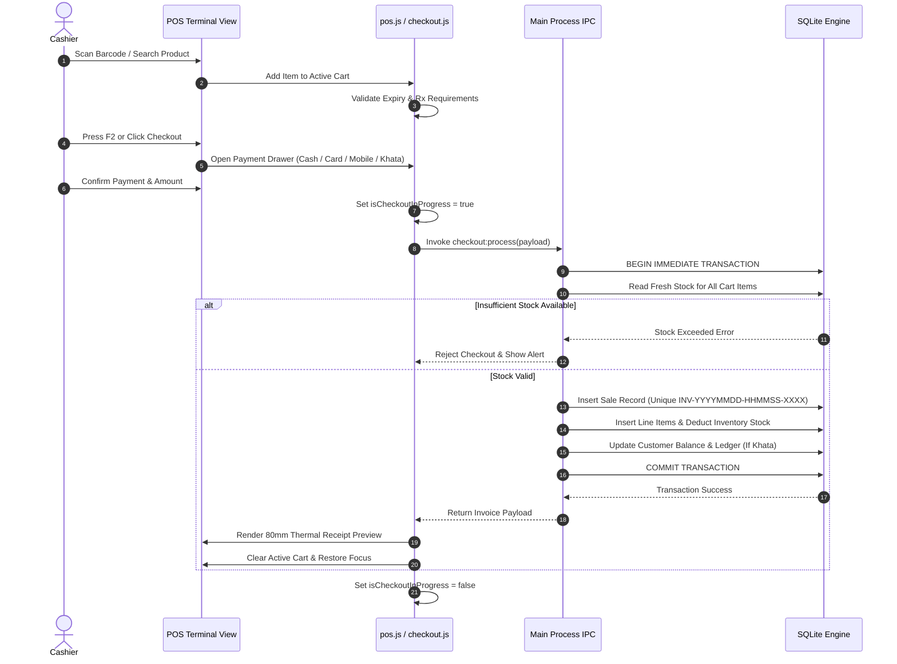

<div align="center">

# 🏥 MediDesk POS & Pharmacy Management System

### *Enterprise-Grade, Offline-First Desktop POS & Inventory Management Software*

[](https://nodejs.org/)
[](https://www.electronjs.org/)
[](https://www.sqlite.org/)
[](https://github.com/M-BilalH/MediDesk-POS)
[-0078D6?style=for-the-badge&logo=windows&logoColor=white)](https://www.microsoft.com/windows)
[](LICENSE)

---

<p align="center">
  <b>MediDesk POS</b> is a production-hardened, offline-first Desktop Point of Sale and Retail Pharmacy Management application. Built with <b>Electron 29 LTS</b>, <b>Node.js</b>, modular vanilla JavaScript, modern glassmorphic UI, and an embedded <b>SQLite WASM engine</b> with crash-safe Write-Ahead Logging (WAL). Designed for lightning-fast barcode workflows, 100% offline autonomy, and strict enterprise security.
</p>

[⬇️ Download Latest Installer (.exe)](https://github.com/M-BilalH/MediDesk-POS/releases) • [📖 System Architecture](#-system-architecture) • [🛡️ Security & Hardening](#-security--production-hardening) • [🚀 Quick Start](#-quick-start--installation)

</div>

---


---

## 🌟 Key Highlights & Modules

| Feature Module | Description & Capabilities |
| :--- | :--- |
| **⚡ 100% Offline SQLite WASM Engine** | Operates completely offline with zero cloud dependency and sub-millisecond response times. Full crash safety via SQLite WAL mode and atomic `.tmp` write operations. |
| **🛡️ Parameterized Named IPC** | Complete elimination of raw SQL queries from the renderer process. Over 35 strictly typed, parameterized IPC channels handle all business logic and storage. |
| **👥 Role-Based Access Control (RBAC)** | Strict privilege tiers (**Admin**, **Manager**, **Cashier**). Cashiers are restricted to retail POS, Khata payments, and quotations while executive reports and settings remain shielded. |
| **📦 Dual-Unit Inventory Management** | Native support for whole **Packs** and loose **Single Tablets** with automatic strip calculations, reorder thresholds, and low-stock telemetry badges. |
| **💳 Customer Khata & Credit Ledger** | Real-time accounts receivable ledger, custom credit limits, payment history tracking, and printable A4 PDF statement generation. |
| **🧾 Thermal Receipts & Protected Attribution** | 80mm ESC/POS thermal receipt rendering, invoice reprinting, prescription image attachment, and permanent immutable developer attribution. |
| **⚠️ 6-Month Predictive Expiry Board** | Early warning radar categorizing medicines into 30-day, 90-day, and 180-day expiry buckets with audited stock zero-out/discard workflows. |
| **🚚 Supplier Restock & PO Builder** | Supplier-grouped reorder sheets, suggested purchase quantities based on low-stock metrics, and exportable formal Purchase Orders. |
| **📊 Executive Analytics Dashboard** | Real-time daily revenue trends, gross volume metrics, payment distribution breakdowns (Cash/Card/Wallet/Credit), and top-selling product leaderboards. |
| **💾 Automated Daily Backups** | Automatic daily database snapshots saved to `Documents/MediDeskPOS/Backups/` with automated recovery and quarantine for damaged files. |

---

## 🛡️ Security & Production Hardening

MediDesk POS has been hardened against common retail POS vulnerabilities:

- **Strict Sandbox & Context Isolation**: Electron `sandbox: true`, `contextIsolation: true`, and `nodeIntegration: false` prevent renderer code from accessing Node.js runtime or shell APIs.
- **Content Security Policy (CSP)**: Enforced via HTTP response headers and `<meta>` security tags to block unauthorized script evaluation and cross-site injections.
- **Zero Raw SQL in UI**: The renderer cannot execute arbitrary SQL. All database mutations happen inside atomic, parameterized main-process handlers.
- **Checkout Idempotency**: Protected against duplicate invoicing caused by double-pressing `F2` or spamming `Enter` during checkout.
- **Stock-Verification Transactions**: Deducts stock only after validating real-time database balances in an atomic transaction, eliminating race conditions from stale cart snapshots.
- **Collision-Proof Invoices**: Sequential, unique invoice format: `INV-YYYYMMDD-HHMMSS-XXXX`.
- **Validation Guards**: Prevents negative discounts, blocks credit sales to walk-in customers, and raises alerts when attempting to sell expired or prescription-only medicines.
- **Operator PIN Protection**: Custom 4–8 digit security PINs with automated rejection of insecure default PINs (`1234`, `5678`, `0000`, `1111`, etc.).

---

## 📐 System Architecture

MediDesk POS separates UI rendering from backend database logic through a secure, modular IPC architecture:

```mermaid
graph
        A["Modern Glassmorphic HTML5 / CSS3"] --> B["app.js Orchestrator"]
        B --> C["15 Focused Feature Modules (/modules)"]
        C --> D["Role-Based Screen & Action Guard"]
    end

    subgraph Secure IPC Bridge
        E["Context-Isolated Preload Bridge (preload.js)"]
        C <--> E
    end

    subgraph Desktop Core Engine (Main Process)
        F["Electron 29 Main Process (main.js)"]
        E <--> F
        F --> G["35+ Named Parameterized IPC Handlers"]
        G --> H["SQLite WASM Engine (sql.js)"]
        H --> I["WAL Mode & Atomic .tmp Persistence"]
        F --> J["Native Windows Silent Print Service"]
    end

    subgraph Local File System Storage
        H <--> K[("medidesk_pos.db")]
        I --> L["/Documents/MediDeskPOS/Backups"]
        F --> M["/Documents/MediDeskPOS/Prescriptions"]
    end
```

---

## 📁 Modular Codebase Structure

The renderer frontend is organized into 15 isolated, single-responsibility modules:

```
src/
├── main.js                  # Main process: Window management, security flags, named IPC handlers, DB persistence
├── preload.js               # Secure ContextBridge: Typed window.api surface (no raw SQL exposure)
├── database.js              # Database schema definitions, indexes, audit_log table, and seed data
└── renderer/
    ├── index.html           # Main UI workspace, modal dialogs, and navigation sidebar
    ├── styles.css           # Glassmorphic dark/light responsive stylesheets
    ├── app.js               # Application bootstrap and initialization orchestrator
    └── modules/
        ├── state.js         # Shared application state variables and pagination counters
        ├── utils.js         # Currency formatting, XSS escaping, toast notifications, requireRole guards
        ├── auth.js          # Security PIN authentication and dynamic role-based UI filtering
        ├── navigation.js    # View router, sidebar toggle, and global keyboard shortcuts
        ├── pos.js           # Barcode search, product grid, cart calculations, and parked orders
        ├── checkout.js      # Atomic payment processing, double-submit lock, thermal receipt rendering
        ├── dashboard.js     # Financial KPIs, revenue trend bar chart, top demanding products
        ├── inventory.js     # Product master table, low-stock filters, add/edit/delete product dialogs
        ├── customers.js     # Khata customer directory, debt tracking, Add Customer modal, A4 ledgers
        ├── suppliers.js     # Supplier profiles and product category management
        ├── restock.js       # Low-stock purchase order builder and printable PO sheets
        ├── expiry.js        # 6-month expiry radar board and audited stock zeroing
        ├── quotation.js     # Quotation draft builder and formal estimate printing
        ├── sales.js         # Historical sales ledger, receipt reprinting, and admin voiding
        ├── users.js         # Operator account directory, role assignment, and PIN management
        └── settings.js      # Store profile configuration, manual backups, and factory reset
```

---

## 🔄 POS Checkout & Transaction Flow



---

## 👥 Role Permissions Matrix

| Feature / Screen | Admin | Manager | Cashier |
| :--- | :---: | :---: | :---: |
| **POS Terminal & Checkout** | ✅ | ✅ | ✅ |
| **Customer Khata (View & Accept Payments)** | ✅ | ✅ | ✅ |
| **Quotation Builder** | ✅ | ✅ | ✅ |
| **Sales History & Reprint Receipts** | ✅ | ✅ | ✅ |
| **Expiry Center (View Warnings)** | ✅ | ✅ | ✅ |
| **Executive Dashboard & Financial Reports** | ✅ | ✅ | ❌ *Hidden* |
| **Inventory Master (Add & Edit Products)** | ✅ | ✅ | ❌ *Hidden* |
| **Suppliers & Categories Management** | ✅ | ✅ | ❌ *Hidden* |
| **Restock Purchase Orders** | ✅ | ✅ | ❌ *Hidden* |
| **Void Historical Invoices** | ✅ | ✅ | ❌ *Hidden* |
| **Discard / Zero-Out Expired Stock** | ✅ | ✅ | ❌ *Hidden* |
| **Delete Products from Catalog** | ✅ | ❌ *Hidden* | ❌ *Hidden* |
| **System Settings, Backup & Restore** | ✅ | ❌ *Hidden* | ❌ *Hidden* |
| **User & Security PIN Management** | ✅ | ❌ *Hidden* | ❌ *Hidden* |
| **Factory Reset & Data Wipe** | ✅ | ❌ *Hidden* | ❌ *Hidden* |

---

## ⌨️ Global Keyboard Shortcuts

| Shortcut Key | Action | Description |
| :---: | :--- | :--- |
| **`F1`** / **`F5`** | Focus POS Search | Instantly switches to POS Terminal and focuses product search |
| **`F2`** | Open Checkout / Pay | Opens payment drawer or triggers payment processing |
| **`F3`** | Focus Discount | Jumps directly to the cart discount input field |
| **`F4`** | Focus Customer | Jumps to customer selection dropdown for Khata sales |
| **`F12`** | Lock Terminal | Locks the terminal immediately and requests security PIN |
| **`Enter`** *(in Search)* | Add Exact Match | Adds scanned barcode or first matching product to cart |
| **`Esc`** | Close Modal | Closes any active modal dialog and restores input focus |
| **`Alt + S`** | Toggle Sidebar | Minimizes or expands the navigation sidebar |

---

## 🚀 Quick Start & Installation

### Option 1: Download Windows Setup Installer (Recommended)

1. Go to the [**GitHub Releases Page**](https://github.com/M-BilalH/MediDesk-POS/releases).
2. Download the latest `MediDesk POS Setup 1.1.0.exe`.
3. Run the installer to install MediDesk POS to your desktop and start menu.

---

### Option 2: Run from Source (Developers)

#### Prerequisites
- [Node.js (v20.x or v22.x LTS)](https://nodejs.org/)
- [Git](https://git-scm.com/)

#### Setup Instructions

```bash
# 1. Clone the repository
git clone https://github.com/M-BilalH/MediDesk-POS.git

# 2. Enter directory
cd MediDesk-POS

# 3. Install dependencies
npm install

# 4. Start application in development mode
npm start
```

#### Build Windows Installer Locally

```bash
# Build 64-bit Windows NSIS setup installer
npm run build:win64

# Build 32-bit Windows installer (for legacy hardware)
npm run build:win32
```

Packaged installers and portable executables are generated inside the `dist/` directory.

---

## ⚙️ Automated GitHub Releases CI/CD

The repository includes an automated workflow (`.github/workflows/build-release.yml`).

To trigger an automated Windows release build on GitHub:

```bash
# Create a release version tag
git tag -a v1.1.0 -m "MediDesk POS Production Release 1.1.0"

# Push tag to GitHub
git push origin v1.1.0
```

GitHub Actions will automatically:
1. Initialize a clean Windows virtual runner.
2. Compile and package the 64-bit and 32-bit NSIS setup installers using `electron-builder`.
3. Create a GitHub Release and attach the setup `.exe` binaries for public download.

---

## 🧾 Receipt Attribution & Copyright

MediDesk POS includes permanently protected developer attribution printed on all thermal receipts and sales vouchers:

```text
==================================================
              Hashmi Medical Store
           Muhammdia Colony St 9 Sargodha
               Tel: 0300-1234567
==================================================
Inv: #INV-20261025-143022-8741      25/10/2026
Cashier: Syed Bilal             Method: CASH
--------------------------------------------------
Panadol 500mg (Pack)        x 2        Rs 300.00
Augmentin 625mg (Strip)     x 1        Rs 450.00
--------------------------------------------------
Subtotal:                              Rs 750.00
Tax (FBR):                               Rs 1.00
Discount:                               -Rs 0.00
Total:                                 Rs 751.00
Paid Amount:                          Rs 1000.00
Change Return:                         Rs 249.00
--------------------------------------------------
       Thank you for choosing MediDesk!
            MediDesk by Syed Bilal
 Software developed by Syed Bilal (contact : 0330-449560)
==================================================
```

---

## 📄 License

Distributed under the **MIT License**. See [`LICENSE`](LICENSE) for complete terms.

---

<div align="center">
  <sub>Developed by <b>Syed Bilal</b> (Contact: 0330-449560) • Built with ❤️ for modern pharmacies and retail businesses.</sub>
</div>
